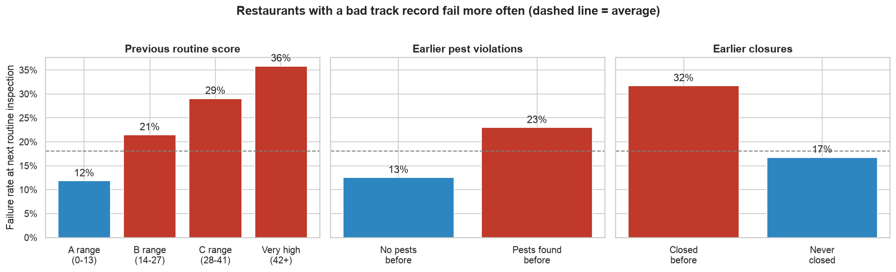
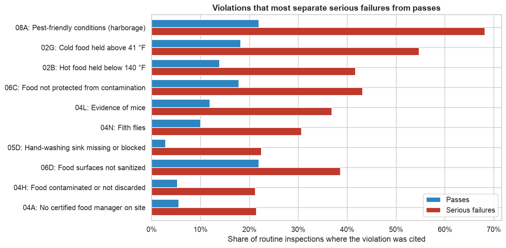
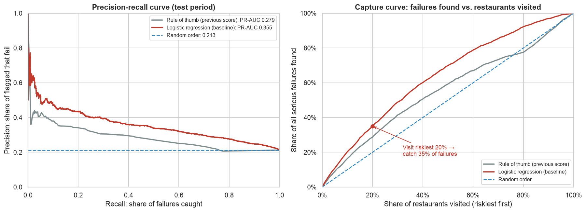
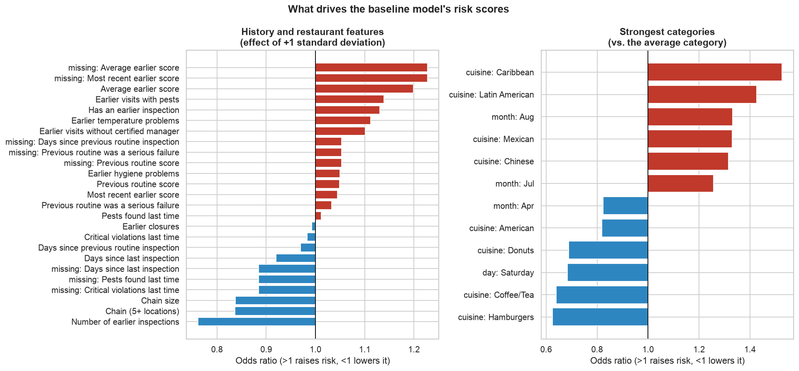

### NYC Food Safety Inspection Model: Exploratory Analysis and Baseline

**Vyom Rawat**

*Predicting which New York City restaurants will seriously fail their next health inspection. UC Berkeley Professional Certificate in Machine Learning and Artificial Intelligence, Capstone Assignment 20.1 (Initial Report and EDA). This is Part 1 of the project; the final model and non-technical report are in Part 2: [nyc-food-safety-inspection-part-2](https://github.com/VyomR/nyc-food-safety-inspection-part-2).*

#### Executive summary

New York City has more than 27,000 actively inspected restaurants and a limited number of health inspectors. This project asks whether the city can predict which restaurants are most likely to **seriously fail their next routine inspection** (28 or more violation points, the C-grade range), using only information known before the inspector walks in.

I cleaned about 294,000 violation records from NYC Open Data, rolled them up to **46,000 routine inspections** (January 2022 to October 2026), and built features from each restaurant's earlier inspections. **18% of routine inspections are serious failures.** The strongest warning signs are a poor track record (earlier high scores, pests, closures), the type of cuisine, not being part of a chain, and summer months.

A **logistic regression baseline** finds failing restaurants at about **twice the rate of random checking**: if inspectors visited the riskiest 10% of restaurants first, 43% of those visits would uncover a serious failure, versus 21% at random. It also beats the simple rule of re-inspecting whoever scored worst last time. Module 24 will compare more advanced models against this baseline.

#### Rationale

Foodborne illness makes about 48 million Americans sick every year, sends around 128,000 to hospital and kills about 3,000 (CDC estimates). Restaurants are a common source of outbreaks. New York's Health Department inspects every restaurant on a cycle, and how soon a restaurant is seen again depends largely on its last score. A restaurant that passed last time but has started cutting corners can go many months unchecked.

If this question goes unanswered, inspectors keep spending visits on clean kitchens while risky ones go unnoticed. A reliable "visit these first" list, built from data the city already collects, would help find unsafe kitchens sooner with the same number of inspectors, and would give restaurant owners clear warning signs to fix before an inspection.

#### Research Question

Using only information available before an inspection, can we predict which New York City restaurants will receive a **serious failing score (28 points or more)** at their next routine health inspection?

#### Data Sources

**Dataset:** [DOHMH New York City Restaurant Inspection Results](https://data.cityofnewyork.us/Health/DOHMH-New-York-City-Restaurant-Inspection-Results/43nn-pn8j), NYC Open Data. A snapshot downloaded on 25 October 2026 is stored in `data/raw/` so the results are reproducible (the city updates the data daily). It has 294,406 rows and 27 columns; each row is **one violation** found during one inspection, with the restaurant's name, location, cuisine, inspection date and type, violation code, critical flag, score and grade.

**Cleaning and preparation** (see [notebook 1](notebooks/01_data_cleaning_and_eda.ipynb)):
* Removed 217 exact duplicate rows and 3,917 placeholder rows dated 1 January 1900 (restaurants not yet inspected).
* Kept inspections from 2022 onward; earlier years are only thinly covered (2,255 rows removed).
* Treated coordinates of (0, 0) and borough code "0" as missing, then filled borough and coordinates from other records with the same ZIP code; 195 rows with no recoverable borough were dropped. Missing cuisine was filled with "Not Listed".
* Rolled violations up to **91,745 inspections**, then kept the **routine first visit of each inspection cycle** (Cycle Inspection / Initial Inspection) as the prediction target.
* **Outliers:** very high scores (up to 157 points) are genuine, coming with many violations and frequent closures, so they were kept; score-history features were capped at the 99th percentile. 77 inspections scored 0 despite critical violations, which is impossible, so they were removed as data-entry errors.

**Final dataset:** 46,000 routine inspections of about 22,000 restaurants, with a binary target (`fail` = score ≥ 28) and 21 features built **only from earlier inspections**, so the model never sees the result it is predicting:

| Feature group | Examples |
|---|---|
| Previous routine inspection | Previous score, whether it was a serious failure, days since then |
| Full inspection history | Most recent and average earlier score, earlier critical violations, number of earlier inspections, days since the last inspection |
| Problem history | Earlier visits with pests, food-temperature problems, hygiene problems, no certified food manager, closures |
| Restaurant | Cuisine group, borough, chain size |
| Calendar | Month, day of week |

#### Methodology

1. **Exploratory data analysis:** distributions, failure rates by category, a map of failure rates, correlation analysis and violation patterns.
2. **Statistical tests:** chi-square tests of independence (with Cramér's V) for categorical features and Mann-Whitney U tests for skewed numeric features, to check which patterns are real.
3. **Time-based split:** trained on the earliest 80% of inspections (January 2022 to April 2026) and tested on the most recent 20% (April to October 2026), to mimic predicting upcoming inspections. A random split would leak future information.
4. **Baseline model:** logistic regression with balanced class weights, inside a scikit-learn pipeline (median imputation with missing-value flags, scaling, one-hot encoding). It was checked with 5-fold time-ordered cross-validation and compared against a do-nothing model and a rule of thumb (rank by previous score).
5. **Evaluation metric:** **PR-AUC (average precision)** as the main metric. Only 18% of inspections fail, so accuracy is misleading: always predicting "pass" is 79–82% accurate but catches nothing. PR-AUC measures how well the model ranks true failures at the top of the list, which is how inspectors would use it. It is paired with a plain-language **capture rate**: the share of all failures found when visiting the riskiest X% first.

#### Results

**What the data shows**



* **Past behavior is the strongest signal.** Restaurants whose previous routine score was very high (42+) fail again 36% of the time, versus 12% after an A-range score. Earlier pest violations (23% vs 13%) and earlier closures (32% vs 17%) also raise the risk.
* **Chains fail about half as often** as independent restaurants (9% vs 20%).
* **Cuisine matters more than borough.** Caribbean (29%), Latin American (27%) and Chinese (25%) restaurants fail most often; donut (5%), hamburger (6%) and coffee/tea (10%) shops least. Queens has the highest borough rate (22%), Staten Island the lowest (14%).
* **Serious failures are driven by** pest-friendly conditions (cited in about two-thirds of serious failures vs one in five passes), food held at unsafe temperatures, and evidence of mice or flies.


* All relationships tested are **statistically significant** (p < 0.001), but each one alone is small to moderate (largest effect size 0.31). No single factor decides the outcome, so a model has to combine them.


**Baseline model (test period: April to October 2026, 9,226 inspections, 21% serious failures)**

| Approach | PR-AUC | ROC-AUC | Failures found when visiting riskiest 10% | ... riskiest 20% |
|---|---|---|---|---|
| Do-nothing (random order) | 0.213 | 0.50 | 10% | 20% |
| Rule of thumb (previous score) | 0.279 | 0.57 | 16% | 29% |
| **Logistic regression (baseline)** | **0.355** | **0.68** | **20%** | **35%** |



* **In plain terms:** visiting the riskiest 10% of restaurants first, **43% of visits** would find a serious failure, versus **21%** at random, about **twice the hit rate**. Visiting the riskiest 20% finds 35% of all serious failures.
* Time-ordered cross-validation on the training period gives PR-AUC **0.297 ± 0.046**, and the model beats both reference approaches in every one of the 5 folds, so the improvement is consistent over time.
* The model's top risk factors match the EDA: poor history, pests, temperature problems, summer months, and certain cuisines. Larger chains and a long record of clean inspections lower the risk.


* The baseline is useful but far from perfect. Inspection outcomes are partly unpredictable, which is why the goal is better **targeting**, not certainty.

#### Next steps

* Compare more models (k-nearest neighbors, decision tree, random forest, gradient boosting), tuned with GridSearchCV and time-ordered cross-validation, against this baseline.
* Choose the decision cut-off to match realistic inspector capacity and compare models on capture rate at that capacity.
* Add features: neighborhood-level failure history, recent 311 rodent and food complaints nearby, and whether a restaurant's scores are improving or getting worse.
* Explain the final model with permutation importance and turn the findings into plain-language recommendations for the Health Department.

#### Outline of project

- [Notebook 1: Data cleaning, EDA and feature engineering](notebooks/01_data_cleaning_and_eda.ipynb)
- [Notebook 2: Baseline model](notebooks/02_baseline_model.ipynb)
- [Summary of findings (Word)](Capstone_20.1_Summary_of_Findings_Vyom_Rawat.docx)

```
├── README.md
├── Capstone_20.1_Summary_of_Findings_Vyom_Rawat.docx
├── requirements.txt
├── data
│   ├── raw/nyc_restaurant_inspections_2026-10-25.csv.gz   # NYC Open Data snapshot
│   └── processed/model_table.csv.gz                        # created by notebook 1
├── images/                                                  # figures used in the README and Word summary
└── notebooks
    ├── 01_data_cleaning_and_eda.ipynb
    └── 02_baseline_model.ipynb
```

**To reproduce:** `pip install -r requirements.txt`, then run the notebooks in order from the `notebooks/` folder.

##### Contact and Further Information

Vyom Rawat · [GitHub: VyomR](https://github.com/VyomR)
